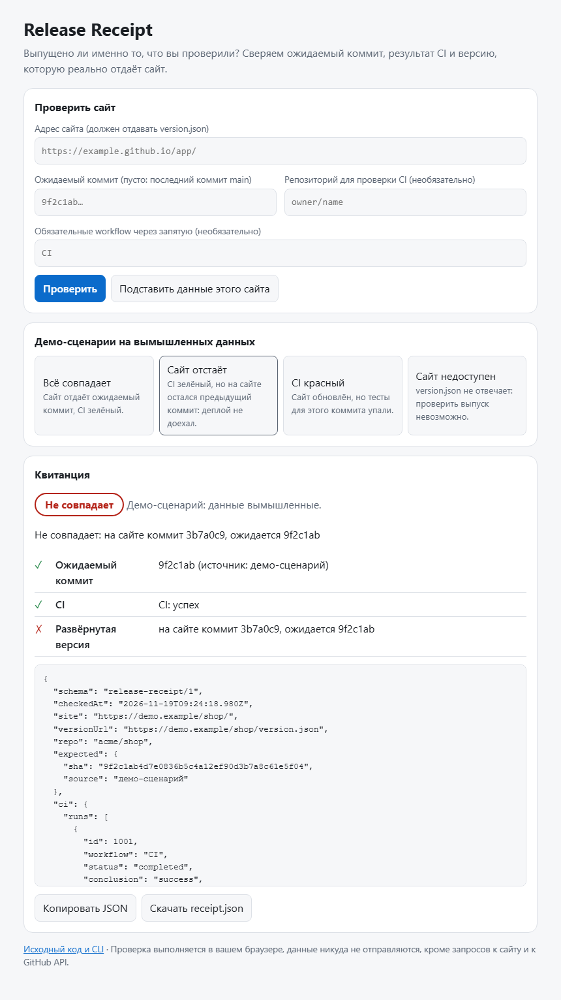

# Release Receipt

[](https://github.com/Oleg4311/release-receipt/actions/workflows/ci.yml)

Отвечает на вопрос «выпущено ли именно то, что мы проверили?». Сверяет три вещи: коммит, который должен быть выпущен, результат CI для этого коммита и версию, которую **реально отдаёт опубликованный сайт**. При расхождении CLI завершается с ненулевым кодом и сохраняет JSON-квитанцию.

**Демо в браузере:** https://oleg4311.github.io/release-receipt/ (есть сценарии «сайт отстаёт», «CI красный», «сайт недоступен» на вымышленных данных и проверка реальных сайтов)



## Быстрый старт

Нужен Node.js 24 или новее. Скачайте `release-receipt.mjs` со страницы [Releases](https://github.com/Oleg4311/release-receipt/releases), сверьте SHA-256 из файла `release-receipt.mjs.sha256` и запустите:

```
node release-receipt.mjs verify https://example.github.io/app/ \
  --sha 9f2c1ab --repo owner/name --workflow CI --out receipt.json
echo $?    # 0 совпало, 1 расхождение, 2 проверить не удалось
```

Сайт должен публиковать `version.json`. Его создаёт команда `stamp` (в CI это одна строка перед деплоем):

```
node release-receipt.mjs stamp --out dist/version.json
```

## Чем отличается

- **Release Please и Changesets** ведут версии и changelog, **attestations GitHub** подтверждают происхождение артефакта. Release Receipt закрывает другой вопрос: *то, что сейчас открывает пользователь, собрано из ожидаемого коммита и прошло CI?*
- Сверяется живой адрес, а не результат сборки: деплой, который «не доехал» или откатился, виден сразу.
- Различает **расхождение** (код 1) и **невозможность проверить** (код 2): недоступный сайт или исчерпанный лимит API не выдаются за провал и не выдаются за успех.
- Может ждать деплой (`--wait`): повторяет проверку, пока Pages или CDN не отдадут новую версию или не истечёт время.
- Квитанция: JSON со схемой `release-receipt/1`, которую можно приложить к релизу или сохранить как артефакт CI.

## Команды

```
release-receipt verify <url-сайта> [параметры]
release-receipt stamp [--out version.json] [--app-version X]
```

| Параметр verify | Что делает |
|---|---|
| `--sha` | ожидаемый коммит (иначе `GITHUB_SHA`, иначе `git HEAD`) |
| `--repo owner/name` | включает проверку CI через GitHub API |
| `--workflow ИМЯ` | workflow, который обязан быть успешным (можно несколько раз); без него достаточно одного успешного запуска и ни одного упавшего |
| `--version-path` | путь к `version.json` (по умолчанию `version.json`) |
| `--wait СЕК`, `--interval СЕК` | ожидание деплоя и пауза между попытками (по умолчанию 5 с) |
| `--out ФАЙЛ`, `--json` | сохранить квитанцию или напечатать её как JSON |
| `--api-base` | адрес GitHub API (для GitHub Enterprise и тестов) |

Токен для API берётся из `GITHUB_TOKEN` или `GH_TOKEN` (без него действует низкий лимит анонимных запросов).

### Пример в GitHub Actions

```yaml
- run: node release-receipt.mjs stamp --out dist/version.json   # до деплоя
# ... деплой ...
- run: >
    node release-receipt.mjs verify https://example.github.io/app/
    --sha ${{ github.sha }} --repo ${{ github.repository }} --workflow CI
    --wait 240 --out receipt.json
  env:
    GITHUB_TOKEN: ${{ github.token }}
```

Так проект проверяет сам себя после каждого деплоя: см. [pages.yml](.github/workflows/pages.yml).

## Как это работает

- `src/core.ts`: чистая логика (сравнение коммитов по префиксу от 7 символов, разбор `version.json`, вердикт). Без сети, поэтому одинаково работает в CLI и в браузере.
- `src/verify.ts`: один проход проверки и цикл ожидания. `fetch` подменяется, поэтому тесты и демо не ходят в сеть.
- Вердикт: любое `fail` даёт `mismatch`, иначе любое `error` даёт `unverifiable`, и только если сайт подтверждён, будет `match`.
- `src/cli.ts`: разбор аргументов, коды выхода, `stamp`. Собирается в один файл esbuild.

## Разработка

```
npm install
npm test            # 28 тестов (node:test), включая запуск настоящего CLI против локального HTTP-сервера
npm run typecheck
npm run build       # сайт в site/ вместе с version.json
npm run e2e         # сценарии в браузере (Playwright; один раз: npx playwright install chromium)
npm run build:cli   # dist/release-receipt.mjs и его SHA-256
```

TypeScript исполняется напрямую (type stripping в Node 24), runtime-зависимостей нет.

## Лицензия

MIT
